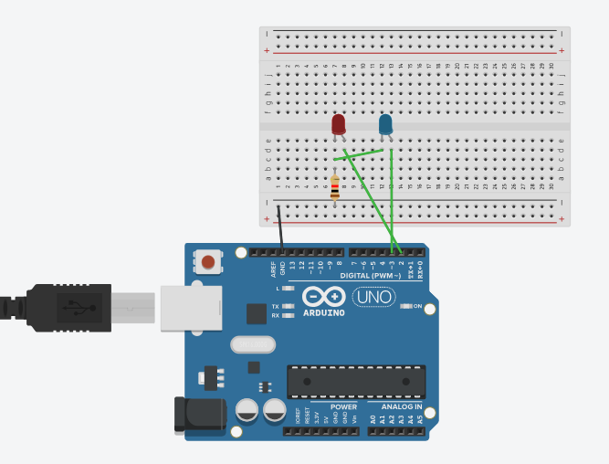
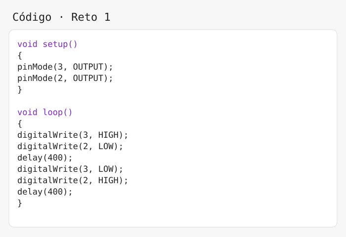
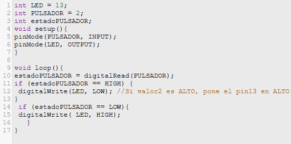
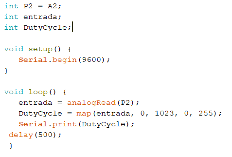
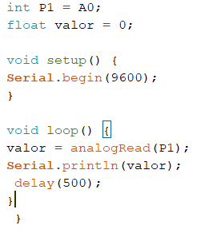
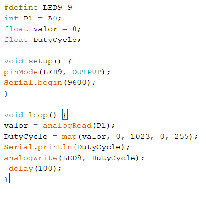

# Cuaderno de Robótica · 4.º ESO

En este cuaderno están las prácticas que hacemos con Arduino. En cada reto se explica qué queremos conseguir, qué componentes usamos y cómo funciona el programa.

## Índice
1. [Reto 1: Dos LED alternativos](#reto-1-dos-led-alternativos)
2. [Reto 2: LED y pulsador](#reto-2-led-y-pulsador)
3. [Reto 3: Potenciómetro y Monitor Serie](#reto-3-potenciómetro-y-monitor-serie)
4. [Reto 4: Lectura del potenciómetro](#reto-4-lectura-del-potenciómetro)
5. [Reto 5: PWM y brillo de un LED](#reto-5-pwm-y-brillo-de-un-led)
6. [Reto 6: Sensor ultrasónico](#reto-6-sensor-ultrasónico)
 6.1. [Reto 6.1: Reto no dirigido](#reto-61-reto-no-dirigido)
 6.2. [Reto 6.2: Reto no dirigido](#reto-62-reto-no-dirigido)  

---

## Reto 1: Dos LED alternativos

### Diagrama de flujo

### ¿Qué queremos conseguir?
Que dos LED se enciendan por turnos: mientras uno está encendido, el otro está apagado. Después de un segundo cambian.

### Materiales
- Arduino
- Protoboard
- 2 LED
- 2 resistencias
- Cables
- Cable USB

### ¿Para qué sirve cada componente?
- **Arduino:** es la placa que ejecuta el programa y controla el circuito.
- **Protoboard:** permite montar el circuito sin soldar.
- **LED:** emite luz cuando circula corriente en el sentido correcto.
- **Resistencia:** limita la corriente para proteger el LED.
- **Cables:** conectan los componentes.
- **USB:** permite cargar el programa y alimentar la placa.

### Circuito

### Código

### ¿Cómo funciona el código?
1. En `setup()` se preparan los pines 2 y 3 como salidas.
2. En `loop()`, Arduino enciende el LED del pin 2 y apaga el del pin 3.
3. Espera 1 segundo.
4. Cambia los LED: apaga el pin 2 y enciende el pin 3.
5. El ciclo se repite continuamente.

### Palabras importantes
- `OUTPUT`: indica que un pin se usará para controlar un componente.
- `HIGH`: pone la salida a nivel alto, normalmente encendiendo el LED conectado correctamente.
- `LOW`: pone la salida a nivel bajo.
- `pinMode()`: configura un pin.
- `digitalWrite()`: cambia una salida a HIGH o LOW.
- `delay(1000)`: espera 1000 milisegundos, es decir, 1 segundo.

### Vídeo de ejemplo

<a href="https://www.youtube.com/watch?v=2f6OHwZokGQ">▶ Ver vídeo en YouTube</a>

---

## Reto 2: LED y pulsador

### Diagrama de flujo

### ¿Qué queremos conseguir?
Controlar un LED con un pulsador. En esta práctica, el LED se apaga cuando pulsamos el botón y se enciende cuando no lo pulsamos.

### Circuito

### ¿Cómo funciona?
1. Se indica que el LED está conectado al pin 13 y el pulsador al pin 2.
2. Arduino configura el LED como salida y el pulsador como entrada.
3. El programa comprueba el estado del pulsador continuamente.
4. Si está pulsado, apaga el LED.
5. Si no está pulsado, enciende el LED.

**Idea clave:** el pulsador sirve para enviar una señal de entrada a Arduino. El LED es una salida que Arduino controla.

---

## Reto 3: Potenciómetro y Monitor Serie

### Diagrama de flujo

### ¿Qué queremos conseguir?
Leer el valor de un potenciómetro y mostrarlo en el ordenador. Al girar el potenciómetro, el valor cambia.

### ¿Cómo funciona?
- `analogRead(A2)` lee la entrada analógica A2.
- La lectura de Arduino normalmente va de **0 a 1023**.
- `Serial.begin(9600)` inicia la comunicación con el ordenador.
- `Serial.println()` muestra el dato en el Monitor Serie.
- `delay(500)` espera medio segundo entre lecturas.

### Código explicado
- **P2 = A2:** guarda qué entrada analógica vamos a usar.
- **entrada:** variable donde se guarda el valor leído.
- **DutyCycle:** variable que puede guardar el valor convertido para controlar una salida PWM.
- **map():** cambia un número de un intervalo a otro, por ejemplo de 0–1023 a 0–255.

### Vídeo de ejemplo

<a href="https://www.youtube.com/watch?v=u_LzLcUyPQk">▶ Ver vídeo en YouTube</a>

---

## Reto 4: Lectura del potenciómetro

### Diagrama de flujo

### ¿Qué queremos conseguir?
Leer el valor de un potenciómetro conectado a A0 y verlo en el Monitor Serie.

### Explicación del programa
- **P1 = A0:** indica la entrada que se va a leer.
- **valor:** variable que guarda la lectura.
- **Serial.begin(9600):** inicia la comunicación con el ordenador.
- **analogRead(P1):** lee un valor entre 0 y 1023.
- **Serial.println(valor):** muestra el valor y pasa a la siguiente línea.
- **delay(500):** espera medio segundo antes de volver a leer.

### Vídeo de ejemplo

<a href="https://www.youtube.com/watch?v=FqHJXZcOIXY">▶ Ver vídeo en YouTube</a>

---

## Reto 5: PWM y brillo de un LED

### Diagrama de flujo

### ¿Qué queremos conseguir?
Cambiar el brillo de un LED usando un potenciómetro. Cuanto más giramos el potenciómetro, más cambia el valor que Arduino manda al LED.

### ¿Qué es PWM?
PWM es una forma de controlar una salida digital encendiéndola y apagándola muy rápido. Así podemos regular, por ejemplo, el brillo de un LED.

### Explicación del código

1. **Variables**
   - `LED9 = 9`: el LED está conectado al pin 9.
   - `P1 = A0`: el potenciómetro se lee desde A0.
   - `valor`: guarda la lectura del potenciómetro.
   - `DutyCycle`: guarda el valor que controla el brillo.

2. **En `setup()`**
   - `pinMode(LED9, OUTPUT)` prepara el pin 9 como salida.
   - `Serial.begin(9600)` permite mostrar datos en el ordenador.

3. **En `loop()`**
   - `analogRead(P1)` lee el potenciómetro (0–1023).
   - `map(valor, 0, 1023, 0, 255)` convierte la lectura a 0–255.
   - `Serial.println(DutyCycle)` muestra el resultado.
   - `analogWrite(LED9, DutyCycle)` cambia el brillo del LED.
   - `delay(100)` espera 100 milisegundos.

**Importante:** para usar PWM en Arduino UNO, el pin debe ser compatible con PWM. El pin 9 sí lo es.

### Vídeo de ejemplo

<a href="https://www.youtube.com/watch?v=ZORLppsyEgE">▶ Ver vídeo en YouTube</a>

---

## Reto 6: Sensor ultrasónico

### Diagrama de flujo

### ¿Qué queremos conseguir?
Medir la distancia a un objeto. En esta práctica, si el objeto está a menos de 15 cm, se activa un LED o aparece un aviso.

### ¿Cómo funciona el sensor?
- **TRIG:** envía una señal ultrasónica.
- **ECHO:** recibe la señal cuando rebota en un objeto.
- Arduino calcula el tiempo que tarda en volver y lo usa para medir la distancia.

### Explicación del programa
- `#include "Ultrasonic.h"`: añade la librería que permite usar el sensor.
- `TRIG_PIN 12` y `ECHO_PIN 11`: indican los pines conectados al sensor.
- `Ultrasonic OurModule(TRIG_PIN, ECHO_PIN)`: crea el objeto que controla el sensor.
- `Serial.begin(9600)`: inicia la comunicación con el ordenador.
- `Serial.println()`: muestra un mensaje en el Monitor Serie.
- `pinMode()`: configura el pin del LED.
- `Serial.print()`: muestra la distancia medida.
- `delay(100)`: espera 100 milisegundos antes de repetir la medición.

### Vídeo de ejemplo

<a href="https://www.youtube.com/watch?v=EXzA4VjIh4Y">▶ Ver vídeo en YouTube</a>

### Reto 6.1: Reto no dirigido 2

**Objetivo:** conseguir que el LED cambie su brillo según la distancia a la que está un objeto. Cuanto más cerca esté, más luminosidad tendrá el LED.

**Diagrama de flujo**

**¿Cómo funciona el código?**
1. Se incluye la librería `Ultrasonic.h`, que permite utilizar el sensor.
2. Se declaran los pines TRIG (4), ECHO (5) y LED (9).
3. En `setup()`, se inicia el Monitor Serie a 9600 y el pin del LED se configura como salida.
4. En `loop()`, el sensor mide la distancia en centímetros.
5. `map()` transforma la distancia en un valor de brillo.
6. `analogWrite()` aplica ese brillo al LED. El valor PWM va de 0 (apagado) a 255 (máximo brillo).
7. El programa espera 100 ms y vuelve a medir.

**Partes importantes**
- `torticulis.read(CM)`: obtiene la distancia en centímetros.
- `map(valor, 0, 1023, 0, 40)`: convierte un valor a otro intervalo. En este código se usa el potenciómetro para establecer el límite.
- `analogWrite(LED, mapa)`: regula el brillo del LED.

**Observación:** el enunciado pide dos LED, pero en la imagen del programa solo aparece uno conectado al pin 9. Para cumplirlo completamente habría que añadir otro LED y controlar su brillo también.

### Reto 6.2: Reto no dirigido 3

**Objetivo:** añadir un potenciómetro para elegir la distancia a la que se activa el LED de emergencia. Al girarlo, se cambia el límite de proximidad.

**Diagrama de flujo**

**¿Cómo funciona el código?**
1. Se declaran los pines del sensor (TRIG 4 y ECHO 5), el LED (9) y el potenciómetro (A0).
2. En `setup()`, se inicia la comunicación serie y se configura el LED como salida.
3. `analogRead(A0)` lee el potenciómetro, con valores de 0 a 1023.
4. `map(valpot, 0, 1023, 0, 40)` convierte esa lectura en una distancia límite de 0 a 40 cm.
5. El sensor ultrasónico mide la distancia real al objeto.
6. Si la distancia es menor que el límite, el LED se enciende y aparece un aviso. Si no, se apaga.
7. Se espera 100 ms y se repite el proceso.

**Partes importantes**
- `valpot`: guarda la lectura del potenciómetro.
- `mapa`: guarda la distancia límite elegida.
- `lecturasoniditos`: guarda la distancia medida.
- `if (lecturasoniditos < mapa)`: comprueba si el objeto está dentro del límite.
- `digitalWrite(LED, HIGH/LOW)`: enciende o apaga el LED.

**Detalle a revisar:** en la captura aparece `map(valpot, 0, 1023, 0, 40)`, por lo que el potenciómetro selecciona un límite entre 0 y 40 cm. La comparación debe usar ese límite para activar el aviso.

