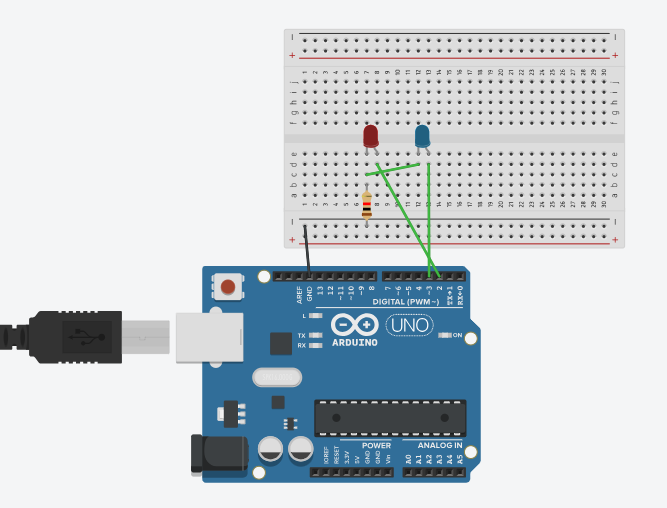
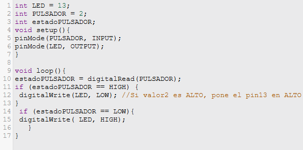
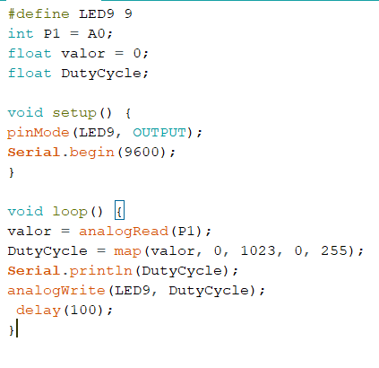

# Reto 1: Encendido alternativo de dos diodos led.
El reto trata de conseguir encender un diodo Led mientras que el otro esta apagado así sucesivamente.
El programa se hace con un Arduino conectando los cables a una Placa de pruebas.

[Pincha aquí para ver la prueba en tinkercad](https://www.tinkercad.com/things/7CJUpBiHZaA-arduino/editel?returnTo=https%3A%2F%2Fwww.tinkercad.com%2Fdashboard)

**La Prueba con Tinkercad:**

El circuito tiene un Arduino conectado a dos LEDs mediante una protoboard. El programa hace que los dos LEDs se enciendan y apaguen alternativamente cada 1 segundo.

El Arduino es el cerebro del circuito y controla los Leds.

La Protoboard sirve para montar y conectar los componentes sin soldar.

Los leds se encienden cuando reciben corriente.

La resistencia limita la corriente para proteger los Leds.

Los cables conectan el Arduino con los diferentes componentes.

El cable USB alimenta el Arduino y permite cargar el programa desde el ordenador.

**El Código:**

Este programa controla dos LEDs conectados a Arduino.
Primero configura los pines 2 y 3.
Después enciende el LED del pin 2 y apaga el del pin 3.
Espera 1 segundo antes de cambiar.
Luego apaga el pin 2 y enciende el pin 3.
Este proceso se repite continuamente.

OUTPUT significa que el pin controla un componente

HIGH significa encendido

LOW significa apagado

pinMode sirve para decirle a Arduino cómo se va a usar un pin

digitalWrite sirve para poner un pin en HIGH o LOW

delay(1000) hace que Arduino espere 1 segundo antes de continuar

**Así quedaría el Reto 1:**

Vídeo realizado por (Lorenzo/@LorenRobótica879)

Licencia estandar de Youtube.

# Reto 2: Encendido de diodos led con pulsador.
**El Código:**

Este programa sirve para encender y apagar una luz LED usando un pulsador.

Primero, le decimos a Arduino que el LED está conectado al número 13 y el pulsador al número 2. 
Después, Arduino prepara el pulsador para recibir información y el LED para encenderse o apagarse.
Luego, Arduino comprueba continuamente si estamos pulsando el botón.

Si el botón **está pulsado, el LED se apaga**

Si **no estamos pulsando el botón, el LED se enciende.**

Todo esto se repite continuamente para que pueda saber siempre qué está pasando.
 

**La Prueba:**

El circuito tiene un Arduino conectado a un LED mediante una protoboard. El programa trata de de si presionas el pulsador el LED se apaga y si no lo presionas el LED esta siempre encendido.

El Arduino es el cerebro del circuito.

La Protoboard sirve para montar y conectar los componentes sin soldar.

El leds se encienden esta siempre enciendo.

La resistencia limita la corriente para proteger el LED.

Los cables conectan el Arduino con los diferentes componentes.

El cable USB alimenta el Arduino y permite cargar el programa desde el ordenador.

# Reto 3: Uso de un Potenciometro y el Monitor Serie

En esta práctica conectamos una placa al ordenador usando varios cables.

Después usamos un programa para ver los números que recibe la placa. Estos números pueden cambiar según la señal que recibe.

En el programa usamos analogRead() para leer los valores y Serial.println() para verlos en la pantalla. También usamos delay(500) para que espere medio segundo entre cada lectura.

# Reto 4:  Mapeado de datos del potenciómetro.
# Reto 5: PWM
En esta práctica usamos Arduino para controlar el brillo de un LED.

El programa lee un valor por el pin A0 y lo convierte en un número entre 0 y 255. Después, envía ese valor al pin 9 para cambiar el brillo del LED.

**El Código:**

**1. Variables**

#define LED9 9: indica que el LED está conectado al pin 9.

int P1 = A0: indica que vamos a leer los valores del pin A0.

float valor = 0: guarda el valor que recibe el programa.

float DutyCycle: guarda el valor que se usará para controlar el LED.

**2. Función setup()**

pinMode(LED9, OUTPUT): prepara el pin 9 para controlar el LED.

Serial.begin(9600): permite enviar datos al ordenador para verlos en la pantalla.

**3. Función loop()**

valor = analogRead(P1): lee el valor que llega al pin A0.

DutyCycle = map(valor, 0, 1023, 0, 255): convierte el valor leído a otro entre 0 y 255.

Serial.println(DutyCycle): muestra el valor en el ordenador.

analogWrite(LED9, DutyCycle): controla el brillo del LED según el valor obtenido.

delay(100): espera 100 milisegundos antes de repetir el proceso.

